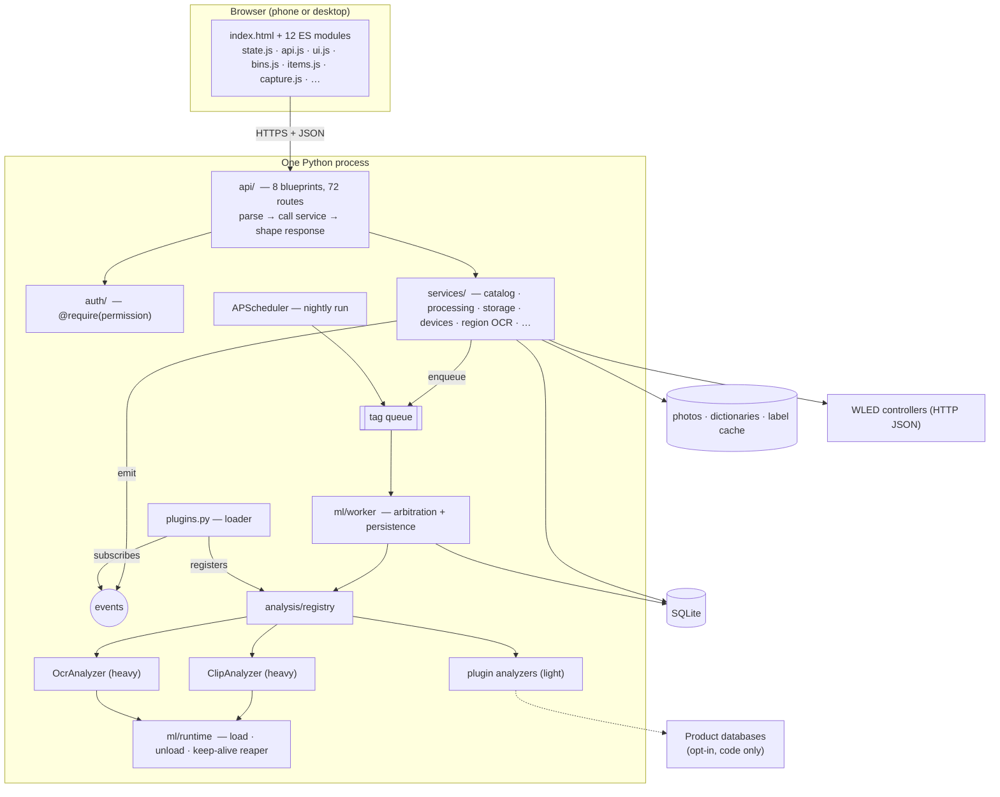
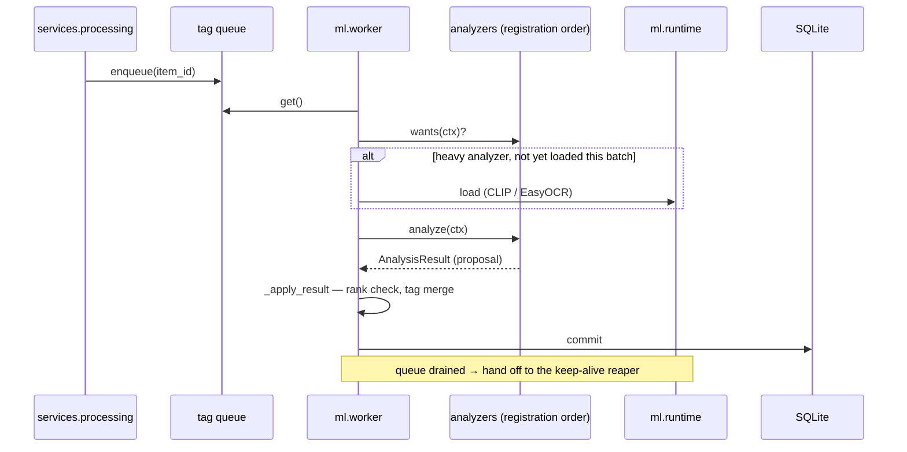
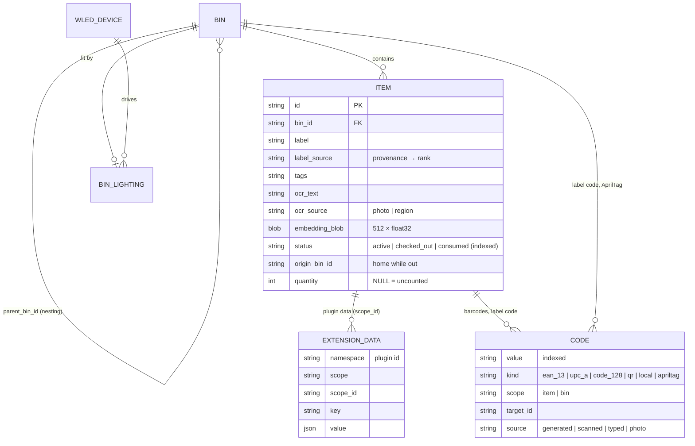

# BINventory — Architecture

How the system is put together, and why. The "why" gets more space than the
"what": the code shows what it does, and this document records the
constraints and trade-offs that shaped it.

**Contents:**
1 [Constraints](#1-constraints) ·
2 [System overview](#2-system-overview) ·
3 [Package layout](#3-package-layout) ·
4 [The analysis pipeline](#4-the-analysis-pipeline) ·
5 [Model lifecycle](#5-model-lifecycle) ·
6 [Embeddings and search](#6-embeddings-and-search) ·
7 [Data model](#7-data-model) ·
8 [Schema migrations](#8-schema-migrations) ·
9 [Plugin system](#9-plugin-system) ·
10 [Events, auth and extension storage](#10-events-auth-and-extension-storage) ·
11 [Lighting](#11-lighting) ·
12 [Frontend](#12-frontend) ·
13 [Deployment](#13-deployment) ·
14 [Verification strategy](#14-verification-strategy) ·
15 [How the architecture evolved](#15-how-the-architecture-evolved) ·
16 [Known limits and next steps](#16-known-limits-and-next-steps)

---

## 1. Constraints

These were fixed up front, and most later decisions follow from them.

| Constraint | Consequence |
|---|---|
| **Local-first, no cloud, no accounts.** Photos never leave the network. | Recognition is on-device ML (CLIP, EasyOCR), not a vision API. External lookups are opt-in, off by default, and send only a barcode number. |
| **Lightweight ML on commodity CPUs**, in the spirit of Immich's CLIP search | `ViT-B-32`, the smallest practical CLIP. Models load on demand and unload when idle. |
| **Single user on a trusted LAN** | No multi-tenant concerns, so a single process, SQLite and an in-process worker thread are enough. Auth is a scaffold, not a feature. |
| **Phone-first, zero-toolchain** | One Flask process serves both the API and a UI made of native ES modules: no bundler, no npm, no build step. |
| **Free and open dependencies, zero-config deploy** | Docker with named volumes, or `python app.py` on any OS. |

---

## 2. System overview



A request never waits on a model. Saving an item writes the photo and the row,
enqueues the item id and returns. The worker thread does the expensive work
and the UI polls `/api/status` for progress.

---

## 3. Package layout

`app.py` is a 50-line entry point. Everything else lives in the `binventory`
package, which is layered so that each concern has exactly one home:

| Layer | Modules | Rule |
|---|---|---|
| **Config** | `config.py` | Paths and environment. Imports nothing from the package, so it can never take part in an import cycle. |
| **Persistence** | `db.py`, `models.py` | One SQLAlchemy instance with no app bound at import time. Models carry no business logic. |
| **Domain services** | `services/items.py`, `bins.py`, `search.py`, `catalog.py`, `processing.py`, … plus `vocabulary.py`, `naming.py`, `lighting.py`, `images.py` | All logic lives here, callable **without HTTP**. Services raise typed errors (`services/errors.py`: `NotFound`, `Invalid`, `Conflict`…); one Flask error handler turns them into status codes, and the MCP server turns them into tool errors. |
| **ML** | `ml/runtime.py`, `ml/embeddings.py`, `ml/worker.py` | Model lifecycle, vector maths, the background queue. |
| **Extensibility** | `analysis/`, `events.py`, `plugins.py`, `auth/` | Contracts that core and plugins both code against. |
| **Transport** | `api/*` | Thin Flask blueprints: parse, call a service, shape a response. |
| **Composition** | `factory.py` | `create_app()` wires config → db → models → blueprints → ML binding, in that order. |

**Why the services layer is strict.** The MCP server, the maintenance CLI,
plugins and automation scripts all need the same operations the HTTP API
exposes. If logic lived in a route handler, each of them would have to either
call the app over HTTP or re-implement it. Building the MCP server forced
that rule to be finished: item lifecycle, bin operations and search had still
been ~690 lines inside route handlers, and moving them into services left the
routes as three-line adapters. The regression suite verified that no
behaviour changed, apart from two missing events that were added on the way. `services/catalog.py` also owns the
canonical JSON shape for bins and items (`bin_dict`, `item_dict`), so the wire
format has a single definition.

**Why `ml` is bound late.** The worker's background threads need an app
context, but importing the app from `ml/` would create a cycle. The factory
passes the app in explicitly with `ml.bind_app(app)`.

---

## 4. The analysis pipeline

### The contract

Anything that derives metadata from a photo is an **Analyzer**
(`analysis/base.py`):

```python
class Analyzer:
    id: str
    cost = "light"            # "heavy" analyzers join the model load/unload lifecycle
    def wants(self, ctx) -> bool: ...      # does this item need me?
    def load(self) / unload(self): ...      # heavy analyzers only
    def analyze(self, ctx: AnalysisContext) -> AnalysisResult: ...
```

`AnalysisContext` hands over an **already EXIF-corrected** image, so no
analyzer ever deals with orientation. `AnalysisResult` carries proposed tags,
a proposed name with its source, an optional embedding and free-form `data`.

The design rule is **analyzers propose, the worker decides**. An analyzer
never writes to the item. That keeps ordering, precedence and persistence in
one place, which is what lets third-party analyzers exist at all.

### Name arbitration

Every name carries a provenance (`item.label_source`), and each provenance has
a rank. The **default** order:

| Rank | Source | Example |
|---|---|---|
| 0 | none | new item, nothing has run yet |
| 1 | `ml` | CLIP's best vocabulary match, e.g. "screwdriver" |
| 2 | `ocr` | whole-photo text read |
| 3 | `scanned`, `scanned_search` | QR text; a barcode looked up in a product database |
| 4 | `ocr_region` | text inside a box the user drew |
| 5 | `agent` | the AI assistant, through the MCP server |
| 6 | `user` | a typed name |

A proposal lands only if its rank is **≥ the stored rank**.

**The order is the user's, not the code's.** It lives in `binventory/naming.py`
as a setting (⚙ → *Name priority*, `GET/PUT /api/settings/naming`), stored in
core settings with no schema change. Someone who trusts their assistant more
than their own typing can put `agent` on top, and someone who prefers barcodes
over everything can do that too. Only full permutations are accepted. Names
typed in the app's own UI are an explicit act and always apply; every other
writer, including the assistant, goes through `naming.may_replace()`. When a
rename is refused, the error says which source outranked it and where the
setting is, so an agent can relay that to the user.

Two refinements came out of real use:

- **Displaced OCR text is kept as a tag, not lost.** A barcode lookup that
  renames an item still leaves the OCR'd part number searchable.
- **Region OCR is sticky.** `item.ocr_source` records whether the OCR text came
  from the whole photo or a user-drawn region. `OcrAnalyzer` discards
  whole-photo reads for region-sourced items, so no bulk re-run (and there are
  six bulk paths) can overwrite a deliberate selection.

Whole-photo OCR originally tied with barcode results at rank 2, so a later OCR
re-run would put packaging noise back over a clean product name. The fix was a
single rank change in one table, which is the benefit of arbitrating in one
place.

### The worker loop



- **Only what is needed loads.** An OCR-only re-run never brings CLIP's
  1.4 GB into memory.
- **Order matters.** Analyzers run in registration order (CLIP, then OCR, then
  plugins), so higher-ranked proposals in the same pass win naturally.
- **Untrusted code is contained.** `wants()` and `analyze()` from plugins are
  wrapped; a raise counts as "no" or as a failed analysis, and the item is
  still saved. An analyzer disabled mid-batch stops running immediately.

**Why a thread rather than Celery or RQ?** For one user, a real task queue
would add Redis, a second process and deployment surface, and buy nothing.
The trade-off is that queue state lives in memory, which is acceptable because
"needs work" is derivable from the database: anything without an embedding,
or with OCR requested but not done, is picked up by the next *Process
pending* or the nightly run.

**One endpoint, two parameters.** Five legacy endpoints (retag one, OCR one,
tag all, re-OCR all, process pending) differed only in *which* items to queue
and whether to *force* work already done. They collapsed into
`POST /api/process {scope: item|bin|pending|all, force}`; the old URLs now
delegate to it.

---

## 5. Model lifecycle

`ml/runtime.py` owns loading, unloading and progress.

- **Load on demand.** Nothing ML-related is imported at startup. The server is
  up in about two seconds; CLIP loads on the first tagging job or semantic
  search.
- **Keep-alive with a reaper.** Each use calls `touch_models()`. A background
  reaper unloads models once they have been idle for the keep-alive window
  (default 60 s, configurable 0–3600 s). A burst of searches, or tagging
  followed by searching, pays the load cost once.
- **Real memory release.** Unloading drops references, runs `gc.collect()` and
  empties the CUDA cache when one exists, so RAM actually returns to the OS.
- **Thread safety.** Loads are guarded by locks and "loading" flags, so
  concurrent requests can't double-load. EasyOCR's `readtext` is serialised
  because a region-OCR request can overlap with the worker.
- **Progress.** `job_reset` / `job_tick` keep a rolling-average duration that
  drives the "N of M · ~ETA" banner.

---

## 6. Embeddings and search

### Tagging: the cached label matrix

CLIP tags a photo by scoring its image embedding against the text embedding of
every vocabulary term. The first implementation re-encoded the whole
dictionary through CLIP's text transformer **for every photo**, which was
about 99 % of tagging time. Now the vocabulary is encoded once into a
normalised matrix, and tagging a photo is one matrix multiply (about 0.25 ms
at 2,300 terms). The matrix is persisted to `label_cache/labels_<hash>.pt`,
keyed by a hash of the vocabulary, so:

- editing a dictionary invalidates the cache automatically, and
- a restart costs a file read, not a re-encode.

The vocabulary only names the tag chips; it does **not** limit search. Search
compares against the full image embedding, which can represent things that
aren't in any dictionary.

### Storage

An embedding is 512 float32 values stored as exactly 2,048 raw bytes in
`item.embedding_blob`. It replaced a JSON text column of 6–8 KB that had to be
parsed on every search. `services/embeddings_store.py` is the only module that
knows the format.

### Query paths

| Path | Mechanism | Threshold |
|---|---|---|
| Keyword | Every query word must match in some field. Score = field weight (name 8, tags and notes 3, OCR text 1) × match quality (whole word 3, word prefix 2, inside a word 0.25), plus bonuses for the exact name or the phrase in order | — |
| Semantic | `embed_text(query)` · stacked, L2-normalised item matrix → cosine scores in one vectorised NumPy operation, sorted, threshold applied, top 50 | text 0.18 (configurable) |
| Photo | `embed_image(photo)` against the same matrix | image 0.55 (configurable) |

Image-to-image scores run much higher than text-to-image scores, which is why
there are two thresholds. Both are stored in settings and clamped to
0.05–0.95. Keyword search is the only path available with the model unloaded,
which makes vocabulary quality matter more than it first appears; that is why
the vocabulary tooling exists (review queue, duplicate and typo detection,
merging with re-tagging).

**Ranking is weighted so the name wins.** The first keyword search was an
unranked substring scan in database order, so "ram" listed five macramé items
before the RAM stick. Weighting by field and by match quality fixes that, and
the "inside a word" weight is set low enough that a whole word in noisy OCR
text still beats a fragment of a name. When CLIP is warm, the results are
merged: items whose *name* matches every query word come first, then the
semantic results, then the remaining keyword hits. That last group also covers
items that haven't been analysed yet and so have no embedding.

---

## 7. Data model



Decisions worth knowing before changing these tables:

- **`status` + `origin_bin_id`** implement checkout and the shopping list
  without moving rows. "Find" and "Restock" still resolve to the item's home
  bin while it is out. "Checked Out" is a virtual bin synthesised by the API,
  not a database row.
- **Nesting moves nothing.** A parent bin *displays* its descendants' items.
  Cycle guards stop a bin being nested inside its own descendant. On delete,
  children are re-parented, not orphaned, and shopping-list items survive
  bin deletion with their origin cleared, so restock asks for a destination.
- **`quantity` is nullable on purpose.** NULL means "not counted", which is the
  honest value for everything that existed before the column did. It is
  stored and shown, and deliberately wired to nothing yet.
- **Lighting is sparse.** `bin_lighting` has a row only for lit bins, pointing
  at a `wled_device`. Re-addressing one controller updates every bin on it.
- **Codes are local identifiers** (`code`, migration 10). A product barcode,
  a printed label's short code and a bin's AprilTag id all resolve the same
  way: scan it, open that bin or item. The same value may sit on two items,
  because two identical products share a UPC, but only after the user
  confirms it. A first attempt answers 409 listing where the value already is.
  Product data looked up *from* a barcode is deliberately not here. It lives
  in the barcode plugin's store, keyed by value, so codes work offline today
  and a later bulk lookup can enrich them without touching this table. The
  table is core rather than plugin storage because a label already stuck on a
  box must keep working with any plugin switched off.
- **Plugins never add columns** (see §9).

---

## 8. Schema migrations

`migrations.py` is a hand-rolled, versioned runner. A `schema_version` table
records what has been applied; migrations are numbered, ordered, and each runs
inside its own transaction.

- **Forward-only, deliberately.** There is no `downgrade()`. Reverse migrations
  that nobody exercises are worse than none, so **the backup is the rollback
  plan**. `backup.py` takes a consistent online copy (SQLite backup API) plus
  photos, dictionaries and a manifest with the schema version and row counts.
- **Fail closed.** A failed migration rolls back and the app **refuses to
  start**, printing the restore commands, rather than running on a
  half-migrated schema.
- **SQLite-aware.** Helpers for `add_column`, `drop_column` and
  `rename_column` fall back to a table rebuild on SQLite builds that lack the
  `ALTER` forms.
- **Fresh installs take the same path as upgrades.** A brand-new database
  replays every migration on top of `create_all()`. That costs a few
  milliseconds and guarantees new and upgraded installs end up with an
  identical schema.

**Why not Alembic?** For a single-developer local app, Alembic adds a
dependency and configuration surface. Its main advantage, autogeneration,
doesn't help with the migrations that actually mattered here: moving lighting
to its own table, JSON → BLOB embedding conversion with verification, and
merging 18 dictionary files into 3.

**Expand, then contract.** Destructive changes shipped in two halves. First,
write both representations, read the new one with fallback to the old, and run
a backfill. Only after hardware sign-off, drop the old representation
(migration 7). The embedding move found 62 rows that existed only in the
legacy format: the "expand" phase surfaced them, and they were backfilled and
verified before anything was dropped.

| v | Migration | |
|---|---|---|
| 1 | `baseline_schema` | Adopts databases from before the runner existed |
| 2 | `item_quantity` | Nullable count |
| 3 | `extension_storage` | Namespaced plugin data and settings |
| 4 | `bin_lighting` | Lighting moves off the bin row (expand) |
| 5 | `embedding_blob` | float32 BLOB beside the JSON column (expand) |
| 6 | `wled_devices` | Controllers become records; existing IPs become devices |
| 7 | `phase4b_cleanup` | Contract: last-chance copy/backfill, then drop 15 legacy columns |
| 8 | `search_thresholds` | Configurable text and image similarity thresholds |
| 9 | `ocr_source` | Whole-photo vs region OCR provenance |

---

## 9. Plugin system

### Principle: only abstract where two implementations exist

Speculative plugin interfaces are the classic route to an architecture that is
both complicated and wrong. The interfaces here were extracted from pairs
that already existed: CLIP and OCR proved the **Analyzer** contract before any
plugin did, and three concrete plugins were named before the loader was built
(barcode/QR, an MCP server, restocking). With only WLED, lighting got a
*minimal* `Actuator` seam and no public API.

### Model: in-process, with honest trust

| | In-process Python (chosen) | Out-of-process over HTTP/stdio |
|---|---|---|
| Analyzer cost per photo | Passes PIL images and NumPy arrays directly | Serialises every image |
| Authoring | A folder with a manifest and one function | A service, a protocol, a deployment |
| Isolation | None: same privileges as the app | Strong |

For a single-user local tool, isolation costs more than it buys, so the docs
say plainly: **plugins run with the app's privileges; install only ones you
trust.** What the loader adds on top of `import`:

- **Fail-soft.** Statuses are `loaded · disabled · missing_deps · incompatible
  · invalid · error`. None of them stops startup, and each is shown in
  Settings with the error and a `pip install` hint.
- **Declared, then enforced where possible.** The manifest lists the
  permissions, actions and settings the plugin wants. `add_analyzer` requires
  `items:write`; `on()` requires `items:read`; an action not declared in the
  manifest is refused; settings are validated against the declared fields.
  `network:external` is listed as a *disclosure*, because in-process code
  can't be sandboxed.
- **Reversible.** Every registration goes through `PluginAPI`, which records
  how to undo it. Enable and disable are live (no restart) and persisted, and
  a `register()` that raises is rolled back, so a half-registered plugin
  can't leave an orphan analyzer behind.
- **Version-gated.** `api_version` must match `plugins.API_VERSION`.

### Data: a namespaced store, never columns

An unbounded set of third-party schemas would make migrations unmanageable.
Plugins instead get `ExtensionStore(plugin_id)`: JSON values keyed by
`(namespace, scope, scope_id, key)`. A plugin can see only its own namespace,
and an item's plugin data is purged when the item is deleted, through the
`item.deleted` event. A plugin analyzer's `result.data` is routed to this
store, **never onto item columns**. Otherwise a plugin could set `label`
directly and bypass precedence. Tags are the one shared field, because
cross-plugin searchability is the point.

### UI: declarative, rendered by core

Plugins ship **no JavaScript into the app's page**. The manifest declares
settings fields, action buttons and item-sheet rows, and
`static/js/plugins.js` renders them with core components. That keeps the UI
safe (no injected script) and visually consistent, and it survived the
frontend restructure untouched. Each plugin gets a panel of its own in the
**Plugins** tab, so its settings sit under it rather than in a shared
Settings sheet.

**Pages, isolated.** Some plugins need more than a form; the label maker is
one. A plugin that declares `web:routes` can call `api.add_route` and declare
a `[page]`, and the Plugins tab shows that page in a frame on the plugin's
panel. `[[links]]` put buttons on the item sheet or bin view that open the
page at a path ("🏷 Print label" → `/?item={id}`). Flask blueprints can't be
unregistered at runtime, so plugins don't get blueprints: one catch-all
`/p/<plugin id>/<path>` route looks the path up in that plugin's own
werkzeug routing table. That table is dropped on disable, so a switched-off
plugin's pages 404 immediately. Declared actions still go through one generic
`POST /api/plugins/<id>/actions/<name>`.

The bundled **barcode_reader** plugin was the proving ground. Barcode support
had been planned as a core feature and was instead built as the first plugin.
It uses OpenCV's barcode and QR detectors (already present through EasyOCR, so
no new dependency) and runs once per photo in about 50 ms. Its online lookup is
opt-in, sends only the code, uses a 5 s timeout and caches results (hits
forever, misses for 7 days).

### Codes, scanning and the label maker

Labels make physical things findable: scan a box to see what's in it, scan
an item to check it out or back in.

- **One resolver for every kind of code** (`services/codes.py`, `GET /c/<code>`,
  `POST /api/scan`).
  - A photo is decoded server-side by `binventory/scanning.py`: OpenCV's
    barcode, QR and ArUco detectors, so no new dependency.
  - Each decoded value is resolved through the `code` table, along with its
    variant spellings: a UPC-A is its EAN-13 with a leading zero, and one of
    our label URLs is its short code.
  - A phone's camera app needs none of this. A QR label holds
    `HTTPS://<host>/C/<code>`, which redirects into the app at that bin or
    item.
  - The URL is printed in upper case on purpose. QR's alphanumeric mode
    covers it, which drops a typical address from a version-3 to a
    version-2 symbol: about 12% more pixels per module on a 1-inch label.
- **Barcodes can be entered at Add Item.** You can scan or type the barcode
  on the packaging while the item photo still goes through CLIP and OCR, or
  add one later from the item sheet. The barcode reader plugin also adds
  barcodes it finds in an item's own photo, skipping any already on something
  else, because a background job has no one to ask. An item sheet can carry
  several codes.
- **Three code styles, chosen by read distance.** A setting picks the style,
  QR by default.
  - **QR** opens in any phone camera at roughly 10× the code's width.
  - **AprilTag** (tag36h11) reads at roughly 40× from a photo in the Scan
    tab. It's meant for a wall of bins, and was chosen with the backlogged
    AR mode in mind. The family has 587 ids, so only bins get one; item
    labels fall back to QR.
  - **Code 128** is for handheld USB scanners, which type into the Scan tab.
    It's off until the *Code 128 barcodes* setting is on (`option_requires`
    hides it in the style list; the plugin refuses it while off).
    OpenCV's decoder reads EAN/UPC but not Code 128, so the encoders here
    (Code 128 and EAN-13 tables) are checked structurally and by round-trip
    for EAN.

  The label maker shows these estimates per size, so you choose with the
  trade-off in front of you.
- **Labels are PDFs sized to the label.**
  - Six Dymo-compatible sizes, 1×1 in to 4×6 in, rendered at the
    LabelWriter's 300 dpi in 1-bit, scaled by whole pixels per module, and
    written by Pillow as one lossless page per label.
  - Generating a PDF needs no driver integration and works the same from a
    phone, a desktop or Docker. Direct printing is a separate design
    question, held back on purpose.
  - Codes are generated on first print and then stable, so a reprint never
    invalidates a label already on a box.
- **Which address a QR label points at** is a real problem on multi-homed
  hosts. On the reference machine a VPN takes the default route with a 10.x
  address a phone on the Wi-Fi can't reach. So the automatic choice ranks
  192.168/16 over 172.16/12 over 10/8, the page lists the other addresses,
  and a setting overrides it. The live smoke test caught this; the unit
  tests couldn't have.

### The MCP server: an inbound API as a plugin

Every earlier extension point had core calling a plugin (analyze this photo,
handle this event). An MCP server is the opposite: an **inbound API surface**
where an external AI agent calls *into* core. Building it as a plugin was the
test of whether the plugin API was really general. It needed four additive
API features, all reusable (API version unchanged):

| Addition | Why |
|---|---|
| `api.add_service(start, stop)` | A long-running component recorded for undo like any registration, so disabling the plugin really closes its port, and a reload stops the old server before starting the new one |
| `api.app_context()` | The SDK runs tools on worker threads, outside Flask's request handling |
| `api.on_settings_changed(fn)` | Changing the port or network mode restarts the server live |
| `api.set_status(fn)` + actions returning `reveal` | Declarative live status rows (with copy buttons) and a show-once secret, with still no plugin JavaScript |

Plus a `network:listen` permission, disclosed on the card like `network:external`.

**Where it runs.** This was the central decision. Three options were
weighed, and the user chose in-process:

| | In-process thread on its own port (**chosen**) | Separate stdio process | Mounted on Flask's port |
|---|---|---|---|
| Shares the loaded CLIP model | yes | no: a second 1.4 GB copy | yes |
| New items reach the analysis queue | yes | **no**: the queue is in-memory in the other process | yes |
| Event bus, activity log | yes | no | yes |
| Cost | a second port, a stop hook | simplest | replace the WSGI server: large blast radius |

A uvicorn thread serves the SDK's Streamable HTTP app (`mcp` 2.x, spec
**2026-07-28**). That revision is stateless, with no handshake or sessions,
so a plugin restart never strands a client.

**Designed for the model, not mirrored from REST.** 75 HTTP routes became
**19 intent-level tools**, plus two resources and two prompts:

- **Answers are human-meaningful.** Results say *where* things are
  (`Garage shelf › Red tote (Garage, wall 2)`), who named the item, and where
  a checked-out item belongs, not just ids. Bins can be referred to by exact
  name, and a near-miss gets "did you mean …".
- **Errors are written for the model to act on.** A refused rename explains
  the name-priority rule and where to change it. "Allow changes" off says
  exactly which switch to flip.
- **Tools carry annotations.** Read tools are marked read-only, and nothing is
  destructive, because v1 has **no delete tools** (a user ruling). Hosts use
  the annotations to auto-approve reads.
- **It asks when it must.** Restocking an item whose bin was deleted would be
  a dead end. The tool instead *asks the user which bin*, through MCP
  elicitation. The SDK carries the question by the 2026 multi-round-trip
  mechanism or the legacy push, depending on the client.
- **It can see.** `view_item_photo` returns the 512 px thumbnail, about
  25 KB, cheap enough for a multimodal model to look before it renames.
  `set_item_tags` lets it replace wrong visual-guess tags too.
- **Measured against the local models.** In a cleanup of 20 real items,
  the assistant looking at thumbnails produced a usable name for all 20.
  CLIP's top tag was right for about 2, because it tends to name the
  packaging ("vacuum sealer bag" for anything in a zip bag). OCR produced
  about 3 usable names: it often had the right words but buried them in
  label noise, or read a different object in the background. That is why
  the default name priority ranks the assistant above CLIP and OCR, and
  below names you type.

**Security model.** The realistic threat isn't a remote attacker. It's a
**prompt-injected agent**: the inventory is full of text from photos and
labels. Defences, in layers:

1. **Local only by default.** Bound to 127.0.0.1 with the SDK's DNS-rebinding
   guard. In Docker, compose publishes the port on the host's 127.0.0.1 only.
2. **The network needs a token.** *Allow other devices* binds to the LAN,
   always requires the access token (created on the card, shown once, stored
   as a SHA-256 hash, compared in constant time), and serves HTTPS with the
   app's own certificate when one exists. The SDK enforces it as an OAuth 2.1
   resource server: 401 before any tool runs.
3. **Permissions checked per call.** Tools bypass Flask's `@require`, so each
   one checks itself against the manifest's permissions, the *Allow changes*
   switch, and the token's scopes. The scopes reuse the app's permission
   vocabulary.
4. **Agent writes are proposals.** They are written as actor `agent` and go
   through name priority, so by default a typed name is never overwritten.
5. **Everything is visible.** Every change appears in *Recent assistant
   activity*, and core events carry `actor="agent"` for any other
   subscriber.
6. **Data, not instructions.** The server's instructions tell the model to
   treat names, notes and OCR text as data.

The contract suite (`tests/mcp_contract.py`, 48 checks) drives the real plugin
through the SDK's own client, in memory and over real HTTP. It covers both
access modes, the rebinding guard, token-less 401s, and that disabling the
plugin closes the port.

---

## 10. Events, auth and extension storage

**Event bus** (`events.py`): `item.created / updated / deleted / tagged /
checked_out / returned / consumed / restocked`, `bin.created / updated /
deleted`, `bulk_session.ended`.

- **Synchronous.** Ordering is obvious and there is no second threading model.
  A slow handler should hand off to the queue itself.
- **Fail-soft.** A raising subscriber is logged and skipped. Losing a
  notification is acceptable; losing an item is not.
- **Fire-and-forget.** Events aren't persisted. An audit trail, if one is ever
  wanted, is just another subscriber.
- **Emitted by services, with an actor.** Because services emit them, an action
  fires the same events whether it came from the UI, a plugin or the AI
  assistant. Each payload carries `actor` (`"user"` / `"agent"`). Handlers take
  `**kwargs`, so payloads can grow without breaking subscribers.

**Auth scaffold** (`auth/`): a `PERMISSIONS` vocabulary (`items:write`,
`lighting:control`, …), an `AuthBackend` interface, and a `@require(perm)`
decorator on 68 routes. The shipped `NullAuthBackend` grants everything to one
implicit owner, so behaviour is unchanged, but the permission strings are the
same ones plugin manifests declare. One mechanism serves both "what can this
user do" and "what is this plugin asking for", and enabling real auth comes
down to one `set_backend()` call.

---

## 11. Lighting

WLED exposes a small JSON API: `GET /json/info` for LED count, firmware and,
on 0.14+, `leds.matrix {w,h}`, and `POST /json/state` to set a segment.

- **Controllers are first-class records** with probe, rename, re-address,
  make-default and delete. Unprobed devices auto-probe when the list loads,
  and linking a bin adopts the controller's geometry.
- **Payloads are a single static state call**, built by one function for
  Find, restock and preview, so the preview always matches what Find lights.
  A strip addresses `start/stop`; a matrix addresses `start/stop` plus
  `startY/stopY`.
- **No serpentine maths, by design.** WLED maps x/y to the physical wiring
  itself. Correcting for it here would double-correct and scramble every
  zone.
- **Only WLED-native effects** (solid, pulse). An earlier server-animated
  "comet" effect streamed frames from a thread. It walked a *linear* LED index
  (so on a matrix it swept wiring order across rows), needed a per-IP
  generation counter to stop animations fighting, and was never proven on
  hardware. It was removed, and the migration converted it to `solid`.

---

## 12. Frontend

`templates/index.html` (markup only) plus 15 native ES modules and 4 CSS
files (tokens → layout → components → features). There is no framework and no
build step.

- **Icons and theme.** Icons are [Lucide](https://lucide.dev) (ISC), shipped as
  one sprite, `static/icons/lucide.svg`, holding only the icons the app uses
  (`build_icons.py` adds more); nothing loads from a CDN. `icons.js` draws them
  (`icon('lightbulb')`) along with the CSS on/off switch and status dots that
  replaced emoji. Colours are tokens in `tokens.css`: graphite with a cyan
  accent, plus a warm "lit" colour kept for bins lit by their LEDs. Plugins
  name an icon in `[[links]]` (`icon = "tag"`), and plugin pages share the
  tokens and sprite. A regression check fails if an emoji returns or an icon
  name is missing from the sprite.

- **`state.js`** exports one mutable object `S`, because ES modules can't
  reassign imported bindings. Every field has a real initialiser: an early
  split left several as `undefined`, and that broke WLED setup on a real
  device.
- **`api.js`** is the only place that calls `fetch`.
- **The `window` bridge.** The markup uses inline handlers, and module scope
  isn't global, so `main.js` attaches handler functions to `window`. Forgetting
  one makes a button silently do nothing, so `tests/scan_frontend.py`
  statically checks every inline handler and every cross-module reference.
- **Cache policy.** `/`, `/static/js/*` and `/static/css/*` are served
  `Cache-Control: no-cache`. Nested module imports carry no version, so mobile
  browsers otherwise kept running stale modules after a fix shipped; with
  revalidation an unchanged file costs a 304.
- **Thumbnails.** Opening a bin once took 20–30 s on weak Wi-Fi while the API
  answered in 30 ms: every grid tile was the full photo. Grids, search results
  and lists now load a 512 px thumbnail (about 26 KB on average versus a
  131 KB photo on the reference library: 18 MB → 3.7 MB). The thumbnail cache
  (`services/thumbnails.py`) is **self-healing** rather than a second source of
  truth. A thumbnail is rebuilt whenever it is missing or older than its
  photo, so rotation, restock photos and `fix-orientation` need no hooks, and
  photos from before the feature are handled on first view with no migration.
  `thumb_url` carries the photo's mtime, so the response is served
  `immutable` and a revisited bin costs no image bytes at all.
- **Tabs.** Bins, Inventory, Search, **Scan** and **Plugins**. The Scan tab
  focuses its text box on open, because a USB or Bluetooth barcode scanner
  types into whatever has focus and ends with Enter. That makes a handheld
  scanner work with no driver or integration. An optional "check in/out on
  scan" mode acts on each scan immediately, with Undo on the result.
- **Pagination.** `GET /api/items?limit&offset` returns a page envelope.
  Without `limit` it still returns a bare list, so non-paging callers didn't
  change. Parent-bin ordering (own items, then by sub-bin) moved server-side so
  grouping holds across pages.

---

## 13. Deployment

- **Image.** Two-stage build: compile in `builder`, copy only the venv into a
  slim runtime. CPU-only PyTorch is installed *first*, so no transitive
  dependency pulls the ~2 GB CUDA wheel. Application files are copied by
  explicit list rather than `COPY .`, so a local DB, certificate or photo can't
  leak into an image even if `.dockerignore` drifts. The container runs as
  non-root UID 1000.
- **State on volumes only.** Every writable path is configurable by
  environment: `BINVENTORY_DB_DIR`, `…_CERT_DIR`, `…_BACKUP_DIR`,
  `…_QUARANTINE_DIR`, plus the model caches. Docker points all of them at one
  named volume, and photos get a second one. An early version kept SQLite in
  the container layer and would have lost the library on the first rebuild.
- **TLS in a container.** The container can't see the host's LAN IP, so
  `HOST_LAN_IP` is passed through as `BINVENTORY_CERT_HOSTS` and written into
  the certificate's SANs. `python -m binventory.healthcheck` probes HTTPS
  (unverified, since it only asks "is it up?") and falls back to HTTP, so the
  healthcheck works in both modes.
- **Resources.** CLIP (~1.4 GB) and EasyOCR (~0.7 GB) can be resident at once,
  so the default memory limit is 4 GB. Steady state, with models unloaded, is
  a few hundred MB.
- **Server.** Flask's built-in threaded server is used for its native TLS
  support and zero extra moving parts. The workload is one user on a LAN, and
  a WSGI server behind a TLS proxy is the upgrade path if that ever changes.

---

## 14. Verification strategy

The recurring failure mode early in the project was **verification that
checked the code loaded, not that it ran**. One example: every test called
`create_app()` directly and none executed `main()`, so a `NameError` in the
startup path shipped. The current harness is built around that lesson.

- **`tests/api_regression.py`: 261 end-to-end checks** through Flask's test
  client, covering consolidation contracts, the lifecycle state machine, bin
  deletion edge cases, WLED registry and matrix payloads, schema invariants
  after the contract migration, configurable thresholds, region-OCR
  precedence across every bulk path, vocabulary merge and re-tag,
  pagination, thumbnails, the maintenance CLI, the plugin loader and plugin
  routes, codes and conflicts, and the label maker. The loader is tested with
  deliberately broken fixture plugins. Labels are checked end to end: every
  size renders at exactly the label's dimensions, and a slightly blurred
  "photo" of a printed QR or AprilTag label, posted to `/api/scan`, has to
  find its bin.
- **It runs against reality when it can.** With a local library present it
  runs on a *copy* of it, so pending migrations meet real rows. Otherwise, or
  with `BINVENTORY_TEST_FRESH=1`, it builds a new database through the normal
  startup path and seeds it. CI runs fresh mode.
- **Hermetic.** WLED HTTP, the ML worker, the OCR engine and online lookups are
  stubbed, dictionaries are copied, and any photo the test writes is removed on
  exit, even after a crash. The suite asserts that the real dictionaries
  folder is byte-identical afterwards.
- **Tests seed their own data** rather than depending on library contents.
  That rule was adopted after a real user action (handling a review-queue
  word) broke a check that expected it.
- **`tests/scan_frontend.py`** statically catches the two bug classes behind
  the "button does nothing" reports.
- **Hardware acceptance.** Each phase ended with a written test script run on a
  real phone, real photos and real WLED strip and matrix hardware. Synthetic
  data had hidden a performance problem completely: flat-grey test photos
  compress to 17 KB, while real ones are 250–600 KB.
- **`tests/mcp_contract.py`: 48 checks** on the MCP server through the SDK's
  own client, in memory and over real HTTP (§9).
- **CI** runs all three suites on Python 3.11 and 3.13, then builds the Docker
  image, boots it, and waits for the healthcheck.

---

## 15. How the architecture evolved

The project began as a single 2,500-line `app.py` and a 3,900-line
`index.html` with inline CSS and JS. It was restructured in seven phases, each
ending runnable and accepted on hardware before the next began:

| Phase | Delivered |
|---|---|
| 0 | Safety net: versioned migrations, backup/restore, file manifest with hashes, regression harness |
| 1 | Frontend split into ES modules and CSS layers, with no build step introduced |
| 2 | Backend split into the application factory, `api/`, `services/` and `ml/` |
| 3 | Analyzer pipeline and centralised name arbitration |
| 4a / 4b | Expand/contract data moves: BLOB embeddings, the lighting table, 18 → 3 dictionaries |
| 5 | WLED device registry, 2D matrix zones, five API consolidations |
| 6 | Configurable thresholds, region OCR, vocabulary management, pagination, maintenance CLI |
| 7 | Plugin loader and the barcode/QR plugin |
| 7b | Services extraction finished; thumbnails; configurable name priority; the MCP server plugin |

Decision records for the refactor live in code comments as short IDs
(`backlog C4`, `E5`, `G6`). They point back to the design log the work was
planned from.

---

## 16. Known limits and next steps

| Item | Notes |
|---|---|
| **Search scale** | The item matrix is rebuilt from BLOBs per query, which is fine into the low thousands. Next steps: an in-memory matrix cache invalidated on write, then an ANN index (FAISS, `sqlite-vec`) at 10k+ items. |
| **Direct printing** | One-tap printing to the LabelWriter from the host. Needs its own design: driver vs. raw protocol, Windows vs. CUPS in Docker, and which machine is "the printer's". PDFs work everywhere meanwhile. |
| **Bulk product lookup** | Enrich every barcode in the inventory from a product database in one go. The data model is ready (codes are local ids; lookups are keyed by value in the barcode plugin's store), but it would break the local-only default, so it stays opt-in and unbuilt. |
| **Code 128 from photos** | `zxing-cpp` would let the Scan tab read Code 128 (and Data Matrix) from photos; today Code 128 labels are for handheld scanners. A new dependency, so it's a decision rather than a fix. |
| **Live camera scanning** | Scanning from the camera preview rather than a still photo. `BarcodeDetector` covers Android Chrome but not iOS Safari, so it needs a WASM decoder too. |
| **Backlog** | AR "find the bin": point the phone at a wall of bins and highlight the right AprilTag. A shelf-photo map: remember where each tag sits in a photo of the shelf. A LiDAR room map, which needs a native app since iOS Safari has no WebXR. An in-app chat with voice (below). Restocking against an external shopping service, which would break the local-only principle. RFID tags. |
| **MCP v2** | Delete tools behind an elicitation confirmation that names exactly what goes; adding an item from a photo the assistant supplies; change notifications over `subscriptions/listen`. |
| **In-app assistant (backlog)** | A floating chat bubble, text or voice, built as a separate plugin that is just another MCP client of the server above, so it inherits the same permissions, name priority and activity log. Voice is transcribed on the server with faster-whisper, so phones only record and upload. Changes apply immediately and each one appears as a card in the chat. Still open: which language model drives it. |
| **Single capture surface** | Merge Add Item, Bulk Add and restock-with-photo into one screen with a mode switch. |
| **Inline handlers** | Move from `onclick=` plus the `window` bridge to `addEventListener`, which would make the bridge (and that scanner check) unnecessary. |
| **Auth** | Only needed if the app ever leaves a trusted LAN; the seam is already in place (§10). |
