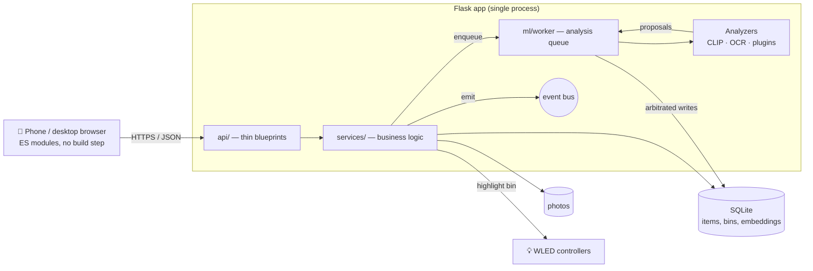

# 🗂 BINventory

**Photograph it, bin it, find it again.** A local-first home and workshop
inventory that recognises what you put away, using on-device machine learning,
and lights up the shelf it went to.


Snap a photo of a socket set and drop it in "Red tote, garage shelf 2".
Months later, type *"socket wrench"*, or *"thing for tightening bolts"*, or
photograph a similar tool, and BINventory shows the item, which bin it is in,
and where that bin lives. If the shelf has a WLED LED strip or matrix panel,
the bin's zone lights up.

Everything runs on your own machine. There are no accounts, no subscriptions,
and no photos leave your network. Recognition uses OpenAI's open CLIP model
and EasyOCR, both running on the CPU.

---

## Highlights

**Recognition pipeline**
- **Zero-shot visual tagging.** CLIP `ViT-B-32` scores each photo against a
  ~2,300-term editable vocabulary. The label matrix is encoded once and cached
  on disk, so tagging a photo costs one matrix multiply (about 0.25 ms) rather
  than a transformer pass per term.
- **Text recognition.** EasyOCR reads printed labels and part numbers. To read
  only one part of a photo, drag a box around it (*Read text in area*); that
  read beats any automatic whole-photo result.
- **Barcodes and QR codes** ship as a plugin. Barcodes found in a photo become
  the item's codes and searchable tags, QR text can name the item, and an
  optional lookup is **off by default**. When on, you pick the sources that
  suit what you store: food, household goods, electronic parts (Mouser,
  Digi-Key), or your own service.
- **One arbitration rule for names.** Every analyzer, plugin and the AI
  assistant *proposes* a name with its source. One rule decides, using an
  order you control (⚙ → *Name priority*; default `visual guess < photo text <
  barcode < selected-area text < AI assistant < typed by you`), so by default a
  name you typed is never overwritten.
- **Models load on demand and unload when idle.** Steady-state RAM stays low
  on a NAS or an old laptop. A configurable keep-alive keeps models warm across
  bursts of work.

**Finding things**
- **Semantic search** ("fastener" finds screws, bolts and nails), **keyword
  search** that works with no model loaded, and **photo search** for when you
  don't know what a part is called.
- **Duplicate check** while adding an item: "do I already own one of these?"
- **Labels and scanning.** Print QR labels for boxes on a Dymo LabelWriter;
  a phone's camera opens the box's contents straight from the label. Scan an
  item's label or its own barcode to check it out or back in, from a photo or
  a USB scanner.
- **WLED "find my stuff"**: per-bin zones on LED strips or 2D matrix panels,
  with a device registry, live preview and solid or pulse effects.

**Organising**
- Nested bins (case → tote → shelf), with parent views grouped by container.
- **Bulk Add**: a live phone viewfinder for rapid intake. Shoot item after item
  and let the pipeline name them.
- Checkout and return, a consume → shopping list → restock lifecycle, and
  type-to-confirm bin deletion that preserves contents.
- A mobile-first UI built from plain ES modules, with no build step and no npm.

**AI assistant (MCP)**
- A built-in **Model Context Protocol server** (spec 2026-07-28) lets an
  assistant such as Claude Code work with your inventory in conversation. It
  can find things ("where are my M3 screws?"), light up the shelf, look at
  photos to give items better names, and move, check out, use up and restock
  items.
- It runs in-process, so it shares the loaded models and analysis queue.
  It is **local-only by default**; other devices need a token and HTTPS.
  It **can't delete anything**, and every change it makes is listed on its panel in the Plugins tab.

**Operations**
- Versioned, transactional schema migrations, consistent online backups, and a
  dry-run-first maintenance CLI.
- A fail-soft plugin system with declared permissions, live enable/disable,
  UI rendered from the manifest, and isolated plugin pages in their own tab.
- Docker image with a healthcheck, or plain Python on Windows, macOS and Linux.

---

## How it works



Saving a photo returns immediately. Analysis runs in a background worker that
loads only the models the queued items need. See
[ARCHITECTURE.md](ARCHITECTURE.md) for the full design and the reasoning behind it.

---

## Quick start

### Option 1: Docker (recommended)

Requires Docker with Compose v2.

```bash
git clone https://github.com/AllenYoungblood/Binventory.git binventory && cd binventory
cp .env.example .env        # optional: set HOST_LAN_IP so phones trust the cert
docker compose up -d
```

The first build takes 5–10 minutes (CPU-only PyTorch and EasyOCR); later
starts take seconds. Then open:

```
https://localhost:5000          this machine
https://<your-lan-ip>:5000      your phone, on the same Wi-Fi
```

Accept the self-signed certificate warning once per device
([why HTTPS?](#https-and-the-phone-camera)).

| Command | |
|---|---|
| `docker compose up -d` | start |
| `docker compose down` | stop (data is kept) |
| `docker compose logs -f` | live logs |
| `docker compose up -d --build` | update after pulling new code |
| `docker compose exec binventory python maintenance.py schema` | run a maintenance command |

**Where data lives.** Docker keeps two named volumes that survive restarts
and rebuilds. Only `docker compose down -v` deletes them.

| Volume / mount | Contents |
|---|---|
| `binventory_uploads` | item photos |
| `binventory_data` | SQLite DB, TLS certificate, CLIP + EasyOCR weights, label-embedding cache, backups |
| `./dictionaries` (bind mount) | tag vocabulary, editable from the host |

**Docker permissions (Linux).** The container runs as UID 1000 and writes to
`./dictionaries` when you promote words from Vocabulary Review. If your user
isn't UID 1000, run `sudo chown -R 1000:1000 dictionaries`.

### Option 2: Local Python

Requires **Python 3.11+** and about 3 GB of free disk space.

```bash
git clone https://github.com/AllenYoungblood/Binventory.git binventory && cd binventory
python -m venv .venv && source .venv/bin/activate      # Windows: .venv\Scripts\activate
pip install torch torchvision --index-url https://download.pytorch.org/whl/cpu
pip install -r requirements.txt
python app.py                                           # or: python start.py
```

The first command keeps pip from pulling the ~2 GB CUDA build of PyTorch. The
server prints the exact URLs for this machine and for your phone. By default,
data lives in the project folder (`binventory.db`, `static/uploads/`); every
location can be moved with the [environment variables](#configuration) below.

### First run

- The server is up in seconds. CLIP and OCR are **not** loaded at startup.
- The first tagging job downloads the CLIP weights (~350 MB, once). The first
  OCR job downloads the EasyOCR models (~100 MB, once). After that, everything
  works offline.
- The header badge shows model state and, while a batch runs, "N of M" with an
  estimated time remaining.

---

## HTTPS and the phone camera

Browsers only allow live camera access (`getUserMedia`) in a *secure context*.
`http://localhost` qualifies, but `http://192.168.1.42:5000` does not, so over
plain HTTP the Bulk Add viewfinder would be blocked on a phone. On first start
BINventory issues itself a self-signed certificate covering `localhost`, every
LAN IP it can detect, and any extra hosts in `BINVENTORY_CERT_HOSTS`. It then
serves HTTPS.

| Browser | To accept the warning once |
|---|---|
| Chrome / Edge | **Advanced** → **Proceed to … (unsafe)** |
| Safari (iOS) | **Show Details** → **visit this website** → **Visit Website** |
| Safari (macOS) | **Show Details** → **visit this website** → enter your password |
| Firefox | **Advanced…** → **Accept the Risk and Continue** |

If your LAN IP changes, regenerate the certificate with
`python generate_cert.py --force` (in Docker, delete the two files in
`/app/data/certs` and restart). If you don't need the live camera, set
`BINVENTORY_HTTP=1`; photo upload still works everywhere.

---

## Configuration

Everything is optional. The defaults suit a local run from the project folder.

| Variable | Default | Purpose |
|---|---|---|
| `BINVENTORY_PORT` | `5000` | Port the server listens on |
| `BINVENTORY_DB_DIR` | project folder | SQLite database and label-embedding cache |
| `BINVENTORY_CERT_DIR` | `./certs` | Self-signed certificate and key |
| `BINVENTORY_CERT_HOSTS` | — | Extra comma-separated IPs or hostnames to put in the certificate |
| `BINVENTORY_HTTP` | `0` | `1` serves plain HTTP |
| `BINVENTORY_BACKUP_DIR` | `./backups` | Where `backup.py` writes |
| `BINVENTORY_QUARANTINE_DIR` | `./orphaned_photos` | Where `maintenance.py orphans --apply` moves stray photos |
| `BINVENTORY_PLUGIN_DIR` | `./plugins` | Plugin discovery folder |
| `BINVENTORY_MCP_BIND` | `127.0.0.1` | Address the AI Assistant plugin binds to in local-only mode (the Docker image sets `0.0.0.0` and compose publishes it on the host's 127.0.0.1) |
| `HF_HOME`, `TORCH_HOME`, `EASYOCR_MODULE_PATH` | library defaults | Model weight caches |

Docker-only (`.env`): `HOST_PORT`, `MCP_PORT`, `HOST_LAN_IP`, and `MEM_LIMIT`
(default `4g`; CLIP and OCR together peak at about 2.5 GB).

---

## Using it

1. **Bins** tab → create bins (name, location, colour). To nest one, open
   it → ✎ → *Nest inside another bin*.
2. Open a bin → **Add Item** (camera or upload), or **⚡ Bulk** for rapid
   intake. Items save instantly and queue for analysis.
3. **Search** tab → type anything. ✨ switches to semantic search; 📷 searches
   by photo. Results show the bin and its location path. Typing a barcode
   finds the item that carries it.
4. **Scan** tab → photograph a box label or a barcode, or type / use a USB
   scanner. A box label opens the box; an item offers check out or return.
5. On an item → **Find** lights its bin; **Check Out** pins it to a virtual
   "Checked Out" bin until it is returned; **Consume** moves it to the 🛒
   shopping list for restocking.
6. **⚙ Settings** → auto-process, nightly schedule, model keep-alive, OCR
   rules, search sensitivity, **name priority**, WLED controllers,
   dictionaries and vocabulary management. **✦ Simplified View** pares the UI
   down for someone who just wants to find things.
7. **Plugins** tab → each plugin with its own settings, and the label maker.

### Name priority

Names come from several places: CLIP's visual guess, text read from the photo,
a barcode, text in an area you selected, the AI assistant, or you typing it.
When a new name is proposed, it replaces the current one only if its source is
at least as high in ⚙ → **Name priority**. Reorder the list with ↑/↓; *Reset
to default* puts the assistant just below names you type. Renaming an item
yourself in the app always applies, whatever the order.

### Search modes

| Mode | How | Needs a model |
|---|---|---|
| Keyword | Word match over names, tags, notes and OCR text, ranked so name matches come first | No, always instant |
| Semantic ✨ | CLIP text embedding against every stored photo embedding | CLIP (~20 s first load, then kept warm) |
| Photo 📷 | CLIP image embedding against stored embeddings | CLIP |

Similarity thresholds are adjustable under ⚙ → *Search Sensitivity*.

### Labels and scanning

Open **Plugins → Labels & Codes** (or 🏷 on a bin or item) to make labels:
pick bins or items, a size and a code style, check the preview, and open
the PDF. Each page is exactly one label. Print it on the LabelWriter at
*Actual size*, with the paper set to the matching Dymo label.

| Size | Dymo label | Good for |
|---|---|---|
| 1 × 1 in | 30332 | small items, small bins |
| 1 × 2⅛ in | 30336 | items, drawers |
| 1¼ × 2¼ in | 30334 | items, small bins |
| 1⅛ × 3½ in | 30252 | bins (the default) |
| 2⅛ × 4 in | 30323 | bins, with a short contents list |
| 4 × 6 in | 1744907 (4XL) | big boxes: a large code and a contents list |

**Code style** is a setting, and the label maker shows the expected read
distance for every size so you can choose:

| Style | Read by | Range (× code width) |
|---|---|---|
| **QR code** (default) | any phone camera; opens the box or item directly | ~10× |
| **AprilTag** | a photo in the Scan tab; built for walls of bins | ~40× |
| **Code 128** | a USB or Bluetooth barcode scanner; off until you turn on *Code 128 barcodes* in the plugin's settings | ~7× |

Text is centred on the code: beside it on wide labels, under it on 1×1
and 4×6. **Text size** (Smallest to Largest) trades letter size for how
much of a long name fits. **↻ Reprint label** on a bin or item opens the
maker set up as it was last printed, with the same code, so the old label
keeps working. If a label is lost or on the wrong box, *Issue a new code*
retires the old one.

**Barcodes as local ids.** When adding an item, scan or type the barcode on
its packaging (the photo is still analysed as usual), or add one later on the
item sheet. Scanning that barcode then finds the item. If a code is already on
another item, you're asked before it's added again, since two identical
products can share one. A label for an item can reuse its own barcode instead
of a new QR. Product lookup stays a separate, opt-in feature of the barcode
plugin, on its own **Product lookup** page (Plugins tab, or 🔎 on an item):
switch on the sources that fit what you store (Open Food Facts, Open
Products Facts, UPCitemdb, Mouser or Digi-Key for parts, or your own URL).
Parts sources look up part numbers as well as retail barcodes.

**Scanning.** *Scan a label or barcode* opens a camera view with a frame:
hold the code inside it and it's read within a second or two. *Take a
photo instead* reads small or distant codes better.

**Check in/out on scan.** In the Scan tab, switch on ⚡ and each item scan
checks it out, or returns it if it's out, with Undo on the result. A USB
scanner works with no setup: it types into the Scan tab's box.

### Vocabulary

Tag vocabulary is plain text in `dictionaries/`, one term per line, `#` for
comments: `base_list.txt` (household, garage, workshop), `electronics_shop_list.txt`
and `custom_list.txt` (yours). Rename a file to `*.off` to disable it, and
apply changes with ⚙ → Dictionaries → *Reload from disk*; no restart is
needed. **Vocabulary Review** mines the names you type and the text OCR reads
into candidate terms. **Manage vocabulary** finds duplicates (case, plurals,
spacing, one-letter typos) and merges them, re-tagging affected items.

### Plugins

Plugins live in `plugins/<id>/` as a `plugin.toml` manifest plus `register(api)`.
They appear in the **Plugins** tab, each with the permissions it declares, its
own settings and, if it has one, its own page. They can be switched on and
off live. A broken plugin is reported there and never stops the app. See
[plugins/README.md](plugins/README.md) to write one. Bundled: **Barcode & QR
Reader** (OpenCV's detectors, no extra install, ~50 ms a photo), **Labels &
Codes** (the label maker) and the **AI Assistant** (below).

---

## Use it with an AI assistant (MCP)

The bundled **AI Assistant (MCP server)** plugin exposes BINventory over the
[Model Context Protocol](https://modelcontextprotocol.io), so any MCP client
can use it as a set of tools. Claude Code, IDE assistants and your own agents
built on an MCP SDK all work.

1. Install its two optional packages (the Docker image already has them):
   `pip install -r requirements-mcp.txt`
2. **Plugins** tab → *AI Assistant (MCP server)* → **On**. The panel shows the
   connection command, for example:
   ```bash
   claude mcp add --transport http binventory http://127.0.0.1:5050/mcp
   ```
3. Ask away: *"Where's the soldering iron?"* · *"Light up the bin with the
   zip ties"* · *"I used the last AA batteries"* · *"What's on my shopping
   list?"* · *"Look at the photos in the Electronics bin and fix the names that
   are only guesses."*

| | |
|---|---|
| **Tools (18)** | search · item details · view photo · list bins · bin contents · shopping list · checked out · overview · rename · update notes/quantity · move · check out · return · use up · restock · create bin · light bin · queue analysis |
| **Also** | resources (`binventory://bins`, item photos) and two prompts (*Find something*, *Tidy up names*) |
| **Can't** | delete items or bins, or change settings |
| **Access** | **This computer only** by default (bound to 127.0.0.1, DNS-rebinding guard on). *Allow other devices* binds to your network, requires the access token you create on the card (shown once, stored as a hash), and serves HTTPS with the app's certificate |
| **Control** | *Allow changes* off = look-only. Names the assistant sets follow ⚙ → *Name priority*. **Recent assistant activity** on the card lists every change it made |

---

## Data, backups and migrations

```bash
python backup.py                    # timestamped backup (DB, photos, dictionaries, manifest)
python backup.py --list
python backup.py --restore <name>   # prompts, and snapshots the current state first
```

The database is copied with SQLite's online backup API, so backups are
consistent while the server is running. In Docker, run
`docker compose exec binventory python backup.py`; backups land in the data
volume, and `docker cp binventory:/app/data/backups ./backups` copies them out.
To restore, stop the stack first (`docker compose stop`), then run
`docker compose run --rm binventory python backup.py --restore <name> --yes`.

The schema is versioned. On startup, pending migrations run in order, each in
its own transaction. If one fails, it rolls back and the app **refuses to
start** rather than run on a half-migrated database. Migrations are
forward-only by design, so **take a backup before upgrading**: the backup is
the rollback plan.

### Maintenance

Anything that changes data is a dry run unless you add `--apply`.

```bash
python maintenance.py schema                   # applied / pending migrations
python maintenance.py orphans [--apply]        # photos with no item (moved, never deleted)
python maintenance.py fix-orientation [--apply]
python maintenance.py thumbnails [--apply]     # pre-build grid thumbnails (otherwise built on first view)
python maintenance.py vacuum [--apply]
python maintenance.py backup [--list | --restore NAME]
```

---

## Development

```bash
python tests/api_regression.py   # 261 end-to-end API checks
python tests/mcp_contract.py     # 48 checks on the MCP server: in-memory + real HTTP
python tests/scan_frontend.py    # static checks on the ES modules + markup
```

The regression suite runs against a **copy** of your local database when one
exists; otherwise, and always with `BINVENTORY_TEST_FRESH=1`, it runs against a
freshly built, seeded one. WLED, the ML worker, OCR and network lookups are
stubbed, so everything runs offline in seconds. CI runs all three on Python
3.11 and 3.13, then builds the Docker image, boots it, and waits for the
healthcheck. See [tests/README.md](tests/README.md).

```
app.py               entry point (create_app + serve)
binventory/          the application package
  api/               Flask blueprints, one per URL area: parse, call a service, shape a response
  services/          business logic, callable without HTTP (CLI, plugins, automation)
  analysis/          Analyzer contract + CLIP and OCR analyzers
  ml/                model lifecycle, embeddings, background worker
  auth/              permission scaffold (null backend: one trusted owner)
  events.py          synchronous, fail-soft event bus
  plugins.py         plugin loader, manifest validation, reversible registration
  naming.py          user-configurable name priority
plugins/             bundled plugins (barcode_reader, mcp_server) + authoring guide
static/js, css       ES modules and CSS; templates/index.html is markup only
dictionaries/        tag vocabulary
tests/               regression + frontend scan
migrations.py        versioned, transactional schema runner
maintenance.py, backup.py, generate_cert.py   operational CLIs
```

---

## Troubleshooting

| Symptom | Fix |
|---|---|
| Phone can't connect | Same Wi-Fi? Allow port 5000 through the firewall. Some routers isolate Wi-Fi clients ("AP isolation"). |
| Bulk Add says *Camera blocked: insecure connection* | Open the `https://` address and accept the certificate. |
| Certificate warning names the wrong address | LAN IP changed: `python generate_cert.py --force` (Docker: set `HOST_LAN_IP`, delete the certs in the data volume, restart). |
| Tagging never finishes | The first load needs internet for the one-time model download. Check the logs. Under ~2 GB of free RAM, raise `MEM_LIMIT` or close other apps. |
| Photos are sideways | `python maintenance.py fix-orientation --apply`, then ⚙ → *Tag All*. Use ↻ Rotate on an item for photos without EXIF data. |
| WLED "Cannot reach device" | `http://<wled-ip>` should open the WLED UI from the same network. |
| `Failed building wheel` on Windows | Use Python 3.11+, which has pre-built wheels, or use Docker. |
| Port 5000 in use | `BINVENTORY_PORT=5001` (Docker: `HOST_PORT=5001` in `.env`). |

---

## Scope

BINventory is deliberately a **single-user application for a trusted home
network**. Authentication is a pluggable null backend: every route already
declares the permission it needs (70 decorated routes), so a real backend can
be dropped in, but none ships. Don't expose it to the internet. Tagging
quality depends on the vocabulary and has not been formally benchmarked.

## How this was built

BINventory began as a 2,500-line single-file Flask app with an inline
3,900-line UI. A seven-phase re-architecture turned it into a layered
package with an analyzer pipeline, an event bus, versioned migrations and a
plugin API, and the app stayed runnable at every checkpoint. The MCP server
then became the plugin API's hardest test: it was the first inbound API
surface rather than an analyzer. Development used a human-directed, AI-assisted workflow. The author set
product direction, constraints and acceptance on real hardware; implementation
was pair-programmed with an AI coding agent; every phase was gated by
automated regression and on-device testing.
[DESIGN_ATTRIBUTION.md](DESIGN_ATTRIBUTION.md) records which decisions came
from where.

## License

BINventory is free for personal and other noncommercial use under the
[PolyForm Noncommercial License 1.0.0](LICENSE): home and hobby use, study,
and use by charities, schools and public bodies. You may change it and share
your changes under the same terms. Commercial use is not permitted.

It is source-available rather than open source. Bundled third-party
components keep their own licences, such as Lucide icons (ISC,
`static/icons/LICENSE-lucide.txt`).
